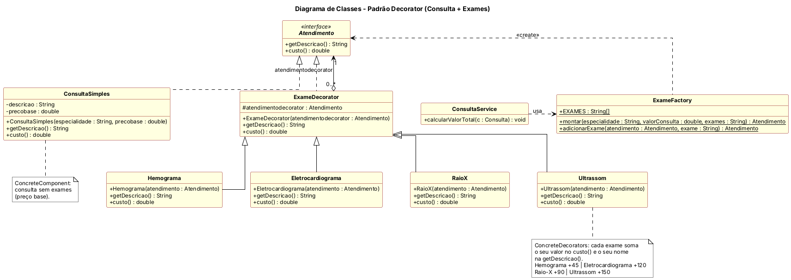
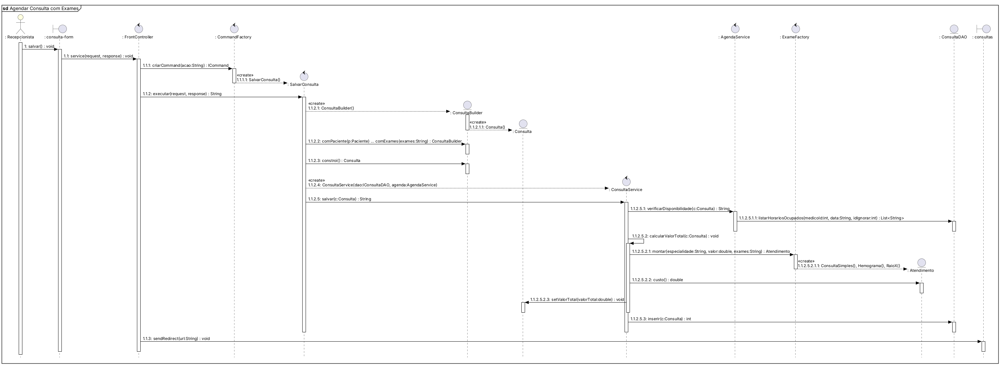

# Clínica - Sistema de Agendamento (V2)

Projeto da disciplina **Padrões de Projeto** (5º semestre de Engenharia de Software - UMC), professor Pedro Toledo.

**Aluno:** Giovane Mateus Pinheiro dos Santos (G07)

Sistema web para agendamento de consultas em clínica médica: cadastro de pacientes e médicos,
agendamento de consultas com exames, registro de atendimento e uma API REST em JSON.

## O que mudou da V1 para a V2

| Item | V1 (M1) | V2 (M2) |
| --- | --- | --- |
| Exames na consulta | não tinha | **Decorator**: cada exame soma no valor total |
| DAOs | classes concretas | interfaces (`IConsultaDAO`...) e **DIP** com injeção pelo construtor |
| Regra de salvar | dentro do Command | `ConsultaService` (usado pelas telas e pela API) |
| API | só telas JSP | **API REST** em JSON com GET, POST, PUT, PATCH e DELETE |
| Testes | não tinha | **25 testes unitários** (JUnit 5 + Mockito + H2, padrão AAA) |
| Exclusão | link GET | formulário POST |
| Diagramas | draw.io | refeitos no padrão UML das aulas (pasta `docs/diagramas`) |

## Tecnologias

- Java 17, Servlet 4 (`javax`), JSP + JSTL
- MySQL 8 / MariaDB (XAMPP) via JDBC
- Maven (gera `target/clinica.war`), Apache Tomcat 9 ou Jetty (plugin do Maven)
- Gson (JSON), JUnit 5, Mockito e H2 em memória (testes)

## Entidades e relacionamentos

- **Consulta** (14 atributos): id, paciente, medico, data, hora, especialidade, tipoAtendimento, status, valor, formaPagamento, observacoes, dataCriacao, exames, valorTotal
- **Paciente**, **Medico**, **RegistroAtendimento**
- **1:N**: um médico (e um paciente) tem várias consultas
- **1:1**: cada consulta tem no máximo um registro de atendimento (`consulta_id UNIQUE`)

## Padrões de projeto e princípios

| Padrão / princípio | Onde |
| --- | --- |
| **Decorator** (sem framework) | `clinica.decorator`: `Atendimento` (Component), `ConsultaSimples` (ConcreteComponent), `ExameDecorator` (Decorator), `Hemograma`, `Eletrocardiograma`, `RaioX`, `Ultrassom` (ConcreteDecorators) |
| **MVC** | Model (`model` + `dao`), View (JSPs em `WEB-INF/views`), Controller (`FrontController`) |
| **Command** | `ICommand` + uma classe por ação no pacote `command` |
| **Factory Method** | `CommandFactory`, `ExameFactory`, `ServiceFactory`, `DAOFactory`, `ConnectionFactory` |
| **Builder** | `ConsultaBuilder` (interface fluente) |
| **DAO** | `ConsultaDAO`, `MedicoDAO`, `PacienteDAO`, `RegistroAtendimentoDAO` |
| **SRP** | DAO só acessa o banco, Command só trata uma ação, `AgendaService` só cuida da agenda, `ConsultaService` só da regra de salvar |
| **OCP** | um exame novo é só um Decorator novo; uma ação nova é só um Command novo |
| **LSP** | qualquer exame substitui `Atendimento` sem quebrar o cálculo; o mock do Mockito substitui o `ConsultaDAO` nos testes |
| **ISP** | interfaces pequenas (`ICommand` com 1 método, `Atendimento` com 2) |
| **DIP** | `AgendaService` e `ConsultaService` dependem de `IConsultaDAO` (abstração), recebida pelo construtor. Commands e APIs pedem os DAOs para a `DAOFactory` e só enxergam as interfaces |
| **Calistenia de Objetos** | sem `else` (retorno antecipado), um nível de indentação nos métodos da agenda, métodos curtos, atributos privados, nomes sem abreviação |

## Regras de negócio (automação)

- Médico não pode ter duas consultas no mesmo dia e horário (consulta cancelada libera o horário).
- Não agenda no passado nem em sábado/domingo.
- Horários de 30 em 30 min: 08:00-11:30 e 13:00-16:30.
- Se o horário estiver ocupado, o sistema sugere os 5 próximos horários livres.
- Valor total = valor da consulta + exames (Hemograma R$ 45, Eletrocardiograma R$ 120, Raio-X R$ 90, Ultrassom R$ 150).

## API REST

Base: `http://localhost:8080/clinica/api`

| Verbo | URL | Descrição | Respostas |
| --- | --- | --- | --- |
| GET | `/consultas` | lista todas as consultas | 200 |
| GET | `/consultas/{id}` | consulta por id + registro de atendimento (1:1) | 200, 404 |
| POST | `/consultas` | cria consulta (passa pela automação da agenda) | 201, 400, 409 |
| PUT | `/consultas/{id}` | atualiza a consulta inteira | 200, 400, 404, 409 |
| PATCH | `/consultas/{id}` | altera só o status | 200, 400, 404 |
| DELETE | `/consultas/{id}` | exclui | 204, 404 |
| GET | `/medicos` | lista médicos | 200 |
| GET | `/medicos/{id}` | médico por id | 200, 404 |
| GET | `/medicos/{id}/consultas` | consultas do médico (1:N) | 200, 404 |
| GET | `/pacientes` | lista pacientes | 200 |
| GET | `/pacientes/{id}` | paciente por id | 200, 404 |

Exemplo de corpo do POST/PUT:

```json
{
  "pacienteId": 1,
  "medicoId": 2,
  "data": "2026-12-01",
  "hora": "09:00",
  "tipoAtendimento": "Presencial",
  "status": "Agendada",
  "valor": 300.0,
  "formaPagamento": "PIX",
  "observacoes": "",
  "exames": "Hemograma,RaioX"
}
```

Exemplo do PATCH: `{ "status": "Cancelada" }`

Quando o horário está ocupado, o POST/PUT devolve **409** com as sugestões:

```json
{
  "status": 409,
  "erro": "O médico já possui uma consulta neste dia e horário.",
  "sugestoes": ["26/11/2026 às 09:00", "26/11/2026 às 09:30"]
}
```

## Telas (endpoints do MVC)

Todas passam pelo `FrontController`: `/clinica/controller?acao=NomeDoCommand`
(ListarConsultas, FormConsulta, SalvarConsulta, VerConsulta, ExcluirConsulta, SalvarRegistro,
ListarMedicos, FormMedico, SalvarMedico, ExcluirMedico, ListarPacientes, FormPaciente, SalvarPaciente, ExcluirPaciente).

## Testes unitários

Ficam em `src/test/java`, seguindo o padrão **AAA** (Arrange, Act, Assert) com cenários positivos e negativos.
Nos services o banco é simulado com o **Mockito** (o DAO "mockado" entra no lugar do `ConsultaDAO`). O `ConsultaDAO` é testado com o banco **H2 em memória** (modo MySQL), sem mexer no `clinica_db`.

| Classe de teste | O que testa |
| --- | --- |
| `ExameDecoratorTest` | custo e descrição com e sem exames, fábrica de exames, exame inválido |
| `AgendaServiceTest` | horário livre, horário ocupado, fim de semana, data no passado, sugestão de horários, agenda lotada |
| `ConsultaServiceTest` | inserir, atualizar, não salvar com conflito, não salvar sem paciente, consulta cancelada, PATCH de status válido e inválido, sugestões com e sem médico |
| `ConsultaDAOTest` (H2) | inserir e buscar por id, id inexistente, horários ocupados sem as canceladas, consultas do médico (1:N) |
| `ConsultaBuilderTest` | valores padrão e especialidade copiada do médico |

## Como executar

1. Rodar `database/script.sql` no MySQL (cria o banco `clinica_db` com dados de exemplo).
2. A senha do MySQL fica no `ConnectionFactory` (padrão vazia, igual ao XAMPP).
3. **NetBeans:** abrir a pasta `clinica` como projeto Maven, Clean and Build e Run (Tomcat 9).
4. **Sem NetBeans (terminal ou VS Code):** `mvnw jetty:run` (ou `mvnw jetty:run -Ddb.senha=root` se o MySQL tiver senha).
5. Abrir `http://localhost:8080/clinica`.
6. Testes: `mvnw test` (ou botão Test no NetBeans).

## Diagramas

Em `docs/diagramas` (fonte `.puml` e imagem `.png`):

- `DC01_Entidades_Relacionamentos` - classes do modelo com as associações 1:1 e 1:N
- `DC02_Decorator_Exames` - estrutura do Decorator
- `DC03_MVC_Command_DIP_API` - camadas, Command, Factory, DIP e API
- `DS01_Agendar_Consulta` - sequência do agendamento com exames (tela)
- `DS02_API_Cancelar_Consulta` - sequência do PATCH na API REST



